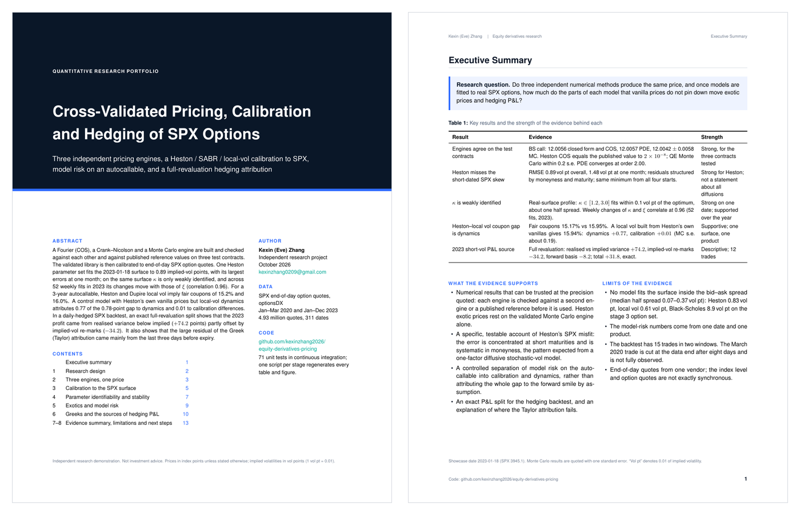

# Cross-Validated Pricing, Calibration and Hedging of SPX Options

[](https://github.com/kexinzhang2026/equity-derivatives-pricing/actions/workflows/tests.yml)

### 📄 [Read the report (PDF, 16 pages)](reports/portfolio/portfolio_report.pdf) · [direct download](https://github.com/kexinzhang2026/equity-derivatives-pricing/raw/main/reports/portfolio/portfolio_report.pdf)

Three independent pricing engines (Fourier, PDE, Monte Carlo) are checked against each other, then calibrated to SPX options and used to separate calibration from dynamics in autocallable model risk, and to attribute hedged P&L exactly.

[](reports/portfolio/portfolio_report.pdf)

*Kexin (Eve) Zhang, October 2026. LaTeX source in [`reports/portfolio/`](reports/portfolio/); a shorter Markdown version is in [`reports/technical_report.md`](reports/technical_report.md).*

## Key results
- **Three methods agree** on three test contracts (a BS call, the Fang–Oosterlee Heston case, the Longstaff–Schwartz American put): COS, Crank–Nicolson (measured order 2.00) and Monte Carlo agree within discretisation or statistical error, and match published or binomial-tree references.
- **SPX calibration**: Heston fits the 2023-01-18 surface to 0.89 vol pt but misses the 1-month skew (1.48 vol pt). On a single surface κ is only weakly identified (κ ∈ [1.2, 3.0] fits within 0.1 vol pt of the optimum). Across 52 weekly fits in 2023, ρ is stable (CV 3%) while κ and ξ move together (weekly-change correlation 0.96). In March 2020 the fit error triples.
- **Model risk**: on the same market, the fair coupon of a 3-year SPX autocallable is 14.0% (BS), 15.2% (Heston), 16.0% (local vol). BS misses the skew. A control model (local vol built from Heston's own smiles) attributes +0.77 of the 0.78-point Heston–local vol gap to dynamics and +0.01 to calibration differences.
- **Hedging**: discrete-hedging error matches Kamal–Derman (0.434 vs 0.441). On real SPX data, short 1-month ATM calls hedged daily earned +31.8 index points in 2023 and lost 127.8 in 2020 Q1. An exact full-revaluation split attributes the 2023 result to realised vs implied variance (+74.2), implied-vol re-marks (−34.2) and forward–index basis (−8.2). The Greek (Taylor) residual is located mainly in the last three days before expiry.

## Stage reports
| Stage | What it covers | Report |
|---|---|---|
| 1 | BS, Heston COS, Crank–Nicolson, Monte Carlo, Longstaff–Schwartz; convergence | [stage1_crossvalidation.md](reports/stage1_crossvalidation.md) |
| 2 | Heston, SABR and local vol calibration to SPX; κ profile; weekly stability | [stage2_calibration.md](reports/stage2_calibration.md) |
| 3 | Barrier put and autocallable under BS / Heston / local vol; vanilla repricing; calibration vs dynamics | [stage3_model_risk.md](reports/stage3_model_risk.md) |
| 4 | MC Greeks, discrete-hedging simulation, SPX backtest with Taylor and full-revaluation attribution | [stage4_hedging.md](reports/stage4_hedging.md) |

Every formula used in the code is derived step by step in [`docs/derivations/`](docs/derivations/).

## Layout
```
src/derivpricing/   models/ engines/ products/ calibration/ hedging/ data/
tests/              property tests: parity, limits, convergence order, attribution identities
reports/            portfolio report (PDF), stage reports, technical report, figures
scripts/            one script per stage regenerates its report
docs/derivations/   every formula used in code, derived step by step
```

## Run
```bash
pip install -e ".[dev]"
pytest                                              # 71 tests, synthetic inputs only
python scripts/stage1_crossval.py                   # stage 1 table and figures
python scripts/stage2_calibrate_spx.py showcase     # one-date SPX calibration
python scripts/stage2_calibrate_spx.py timeseries   # weekly fits
python scripts/stage2_spx_kappa_profile.py          # kappa profile on the real surface
python scripts/stage3_model_risk.py                 # autocallable model risk
python scripts/stage4_hedging.py                    # hedging simulation + SPX backtest
```

## Data
SPX end-of-day option quotes from [optionsDX](https://www.optionsdx.com) (free registration). Put the monthly files in `data/optionsdx/` (`.txt` or `.txt.gz`); they are not redistributed here. Unit tests need no market data.
