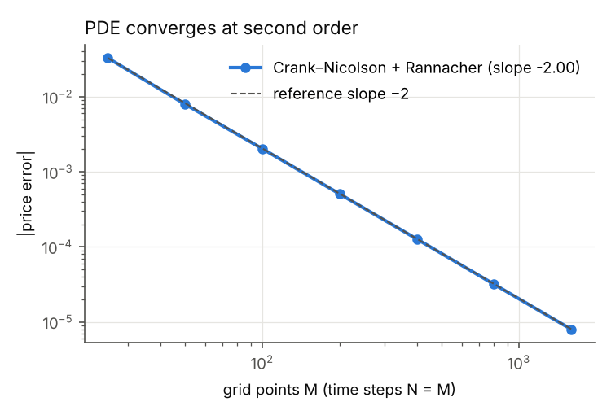
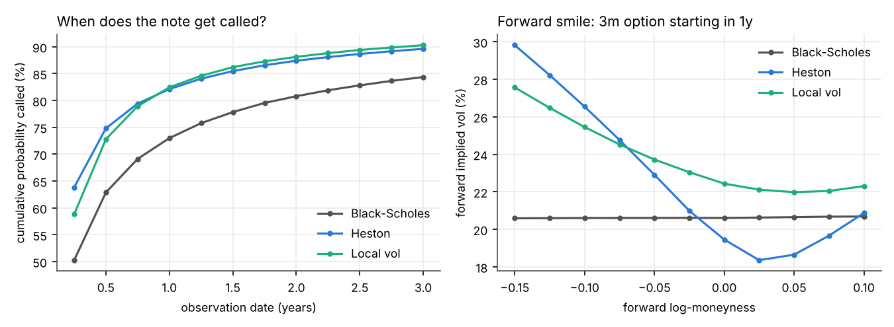

# Derivatives Pricing Engine

[](https://github.com/kexinzhang2026/equity-derivatives-pricing/actions/workflows/tests.yml)

One product, three independent pricing methods, checked against each other — then calibrated to real SPX options and used to measure model risk on an autocallable.

| Module | Status |
|---|---|
| Black-Scholes closed form, Greeks, implied vol | ✅ tested |
| Heston via COS (Fourier) | ✅ tested against an independent Fourier method |
| Crank–Nicolson PDE, Rannacher start, American via penalty | ✅ measured order 2.00 |
| Monte Carlo: antithetic, control variates, Heston QE, Longstaff–Schwartz | ✅ tested |
| Market data: implied forward from parity, OTM IV surface | ✅ tested |
| Heston (whole surface) and SABR (per expiry) calibration to SPX, 2020 Q1 + 2023 | ✅ [stage 2 report](reports/stage2_calibration.md) |
| Dupire local volatility from SVI, local-vol PDE | ✅ reprices Heston vanillas within 0.03 vol pt |
| Barriers (closed form / PDE / MC) and a 3y autocallable (PDE / MC) | ✅ tested |
| Model risk: same SPX surface, BS vs Heston vs local vol | ✅ [stage 3 report](reports/stage3_model_risk.md) |
| MC Greeks (pathwise, likelihood ratio), hedging simulation and real SPX hedging backtest with P&L attribution | ✅ [stage 4 report](reports/stage4_hedging.md) |

## Stage 1 result: three methods, one price
See [reports/stage1_crossvalidation.md](reports/stage1_crossvalidation.md).



**Full write-up: [technical report](reports/technical_report.md) · [portfolio report (PDF)](reports/portfolio/portfolio_report.pdf), LaTeX source in `reports/portfolio/`.**

## Headline results
- **Three methods agree** on three test contracts (a BS call, the Fang–Oosterlee Heston case, the Longstaff–Schwartz American put): COS, Crank–Nicolson (measured order 2.00) and Monte Carlo, within discretisation or statistical error and against published or tree references.
- **SPX calibration**: Heston fits 2023 surfaces to ~0.8 vol pt but misses the 1-month skew; on a single surface κ is only weakly identified (κ ∈ [1.2, 3.0] fits within 0.1 vol pt of the optimum); across 52 weekly fits in 2023 ρ is stable (CV 3%) while κ and ξ move together (weekly-change correlation 0.96). In March 2020 the fit error triples.
- **Hedging**: discrete-hedging error matches Kamal–Derman (0.434 vs 0.441). On real SPX data, short 1-month ATM calls hedged daily earned +31.8 index points in 2023 and lost 127.8 in 2020 Q1. An exact full-revaluation split attributes the 2023 result to realised vs implied variance (+74.2), implied-vol re-marks (−34.2) and forward–index basis (−8.2); the Greek (Taylor) residual is located mainly in the last three days before expiry.
- **Model risk**: on the same market, the fair coupon of a 3y SPX autocallable is 14.0% (BS), 15.2% (Heston), 16.0% (local vol). BS misses the skew. A control model (local vol built from Heston's own smiles) attributes +0.77 of the 0.78-point Heston–local vol gap to dynamics and +0.01 to calibration differences.



## Data
SPX end-of-day option quotes from [optionsDX](https://www.optionsdx.com) (free registration). Put the monthly files in `data/optionsdx/` (`.txt` or `.txt.gz`); they are not redistributed here.

## Layout
```
src/derivpricing/   models/ engines/ products/ calibration/ hedging/ data/
tests/              property tests: parity, limits, convergence order
reports/            stage reports, technical report, figures
scripts/            one script per stage regenerates its report
docs/derivations/   every formula used in code, derived step by step
```

## Run
```bash
pip install -e ".[dev]"
pytest                              # 70 tests
python scripts/stage1_crossval.py   # regenerate the stage 1 table and figures
python scripts/stage2_calibrate_spx.py showcase     # one-date SPX calibration
python scripts/stage2_calibrate_spx.py timeseries   # weekly fits (~10 min)
python scripts/stage3_model_risk.py                 # autocallable model risk
python scripts/stage4_hedging.py                    # hedging simulation + SPX backtest
python scripts/fetch_spx_chain.py   # daily live SPX snapshot from Yahoo (run in market hours)
```
