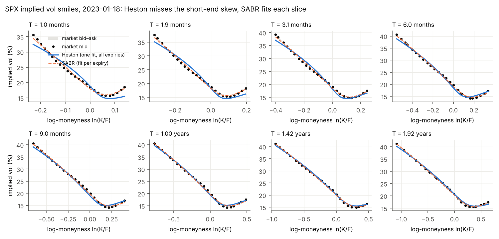
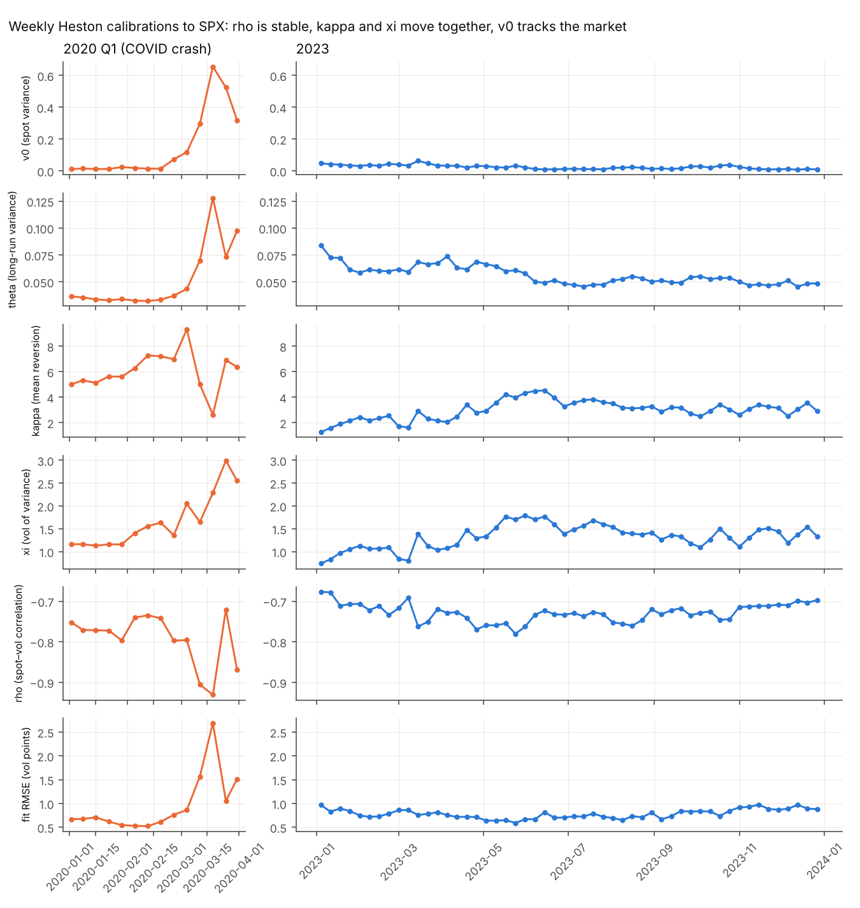

# Stage 2 · Calibrating Heston, SABR and local vol to SPX

Data: optionsDX SPX end-of-day quotes (16:00 ET), Jan–Mar 2020 and all of 2023. Per date: two-sided quotes only, forward and discount implied from put-call parity, OTM options, 8 target tenors from 1 month to 2 years, 25 strikes per tenor. Regenerate with `python scripts/stage2_calibrate_spx.py showcase|timeseries`.

## One date in detail: 2023-01-18
| | Heston (5 parameters, whole surface) | SABR (3 parameters per expiry, β = 1) |
|---|---|---|
| RMSE, all expiries | 0.89 vol pt | 0.43 vol pt |
| 1-month expiry | 1.48 vol pt | 0.54 vol pt |
| 2-year expiry | 0.49 vol pt | 0.35 vol pt |

Heston: v0 = 0.039, κ = 1.89, θ = 0.072, ξ = 0.97, ρ = −0.71 (Feller ratio 0.29, violated).

**Findings**
1. **Heston cannot produce the short-dated skew.** Its error falls steadily with maturity (figure `spx_fit_error_by_expiry.png`). In Heston the skew at short maturities comes only from the correlated variance diffusion, which needs time to act; the market's 1-month skew is steeper than any diffusive stochastic-vol model allows without extreme ξ. This is the standard motivation for jumps (Bates) or rough volatility.
2. **The residual map has structure, not noise** (`spx_heston_residuals.png`): at short maturities Heston is too low in the deep put wing and too high around the money. This points to a model limitation rather than an optimiser failure: four of four starts reach the same minimum on this date (3 of 52 weekly dates in 2023 have a start that ends more than 1% worse). It does not rule out every optimiser or bound effect, and it says nothing about diffusive models other than Heston (local vol, for example, fits the short end far better).
3. **SABR's ν decays with maturity** (2.25 at 1 month to 0.58 at 2 years, roughly ∝ T^(−0.45)). Per-expiry fits absorb the term structure into parameters that change with T, which is why SABR fits better but is not a dynamic model of the surface.
4. **Both models stay well outside the bid–ask spread** (median half spread about 0.08 vol pt). Only 13% of Heston model vols fall inside the market spread.
5. **Local vol skew ≈ 2 × implied skew** at the money (measured ratio 1.95, `spx_local_vs_implied.png`). This is the classic short-maturity result: implied vol at strike K is approximately the average of local vol along the path from spot to K, so the slope halves.

## Parameter stability: weekly fits, 2020 Q1 and 2023
One calibration per calendar week: the Wednesday, or the nearest trading day in that week. 14 dates in 2020 Q1, 52 in 2023. (An earlier version grouped weeks within each monthly file, so weeks spanning two months were fitted twice: 59 dates in 2023. The statistics below are recomputed on the 52 unique weeks; none moved by more than rounding.)

2023 (52 weekly fits):

| | mean | coefficient of variation | correlation of weekly changes with Δκ |
|---|---|---|---|
| ρ | −0.73 | 3% | −0.23 |
| θ | 0.056 | 16% | −0.26 |
| ξ | 1.32 | 20% | **0.96** |
| κ | 2.99 | 25% | 1 |
| v0 | 0.024 | 53% | 0.06 |
| fit RMSE | 0.78 vol pt | 12% | |

**Findings**
1. **ρ is the stable parameter** (CV 3%): the skew of SPX is a persistent feature.
2. **κ and ξ move together**: the correlation of their week-on-week changes is 0.96. Co-movement alone does not prove weak identification (both could move because the market did), so the κ profile was also run on the real surface of 2023-01-18 (`spx_kappa_profile.png`, `stage2_spx_kappa_profile.csv`): holding κ anywhere between 1.2 and 3.0 and refitting the rest raises the RMSE by at most 0.1 vol pt, about one median half spread, while the fitted ξ moves from 0.84 to 1.18. Outside that range the error rises clearly (+0.4 vol pt at κ = 0.5, +0.8 at κ = 10). So κ is weakly identified, to roughly a factor of 2.5, with ξ compensating along the valley; it is not completely unidentified. Practical consequence: a hedge that depends on κ alone (for example, vega to the long-run variance) is unreliable, and recalibrating daily injects noise into P&L. Remedies: fix κ and recalibrate the rest, or penalise changes from yesterday's parameters.
3. **v0 is a state variable, not a parameter.** It should move, and it does: √v0 has correlation 0.99 with 1-month ATM implied vol.
4. **COVID crash**: from 2020-02-19 to 2020-03-18, v0 rises from 0.014 to 0.655 (√v0 from 12% to 81%), ρ falls to −0.93, ξ rises from 1.6 to 2.3 (3.0 a week later), and the fit RMSE rises to 2.7 vol pt. A 5-parameter diffusion fits a calm surface well and a crisis surface badly, exactly when the model matters most.
