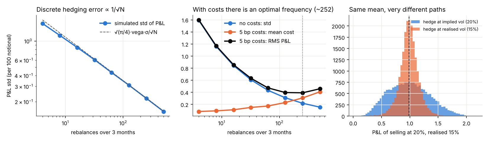
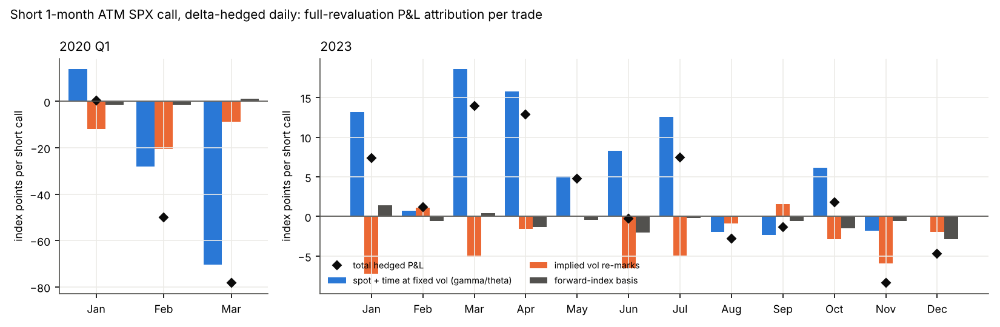

# Stage 4 · Greeks and hedging: where the hedging error comes from

## A. Simulation (Black-Scholes world, 3-month ATM call, σ = 20%)
- Discrete hedging, 63 daily rebalances: P&L std 0.434 vs Kamal–Derman √(π/4)·vega·σ/√N = 0.441 (per 100 notional). Halving the error needs 4× the trades.
- 5 bp transaction costs: cost grows like √N while hedging error falls like 1/√N; RMS P&L is minimised around N ≈ 252 rebalances.
- Selling at 20% implied when realised is 15%: expected profit 0.986. Hedging with implied-vol deltas: mean 0.987, std 0.354. Hedging with realised-vol deltas: mean 0.986, std 0.163.
  Same expected profit; with realised-vol deltas the P&L is locked in (but you must know realised vol), with implied-vol deltas it accrues as ½Γ S²(σ_imp² − σ_real²) and depends on the path of gamma.

## B. Real SPX: short 1-month ATM call each month, hedged daily
Entry on the first trading day of each month at mid; strike nearest the implied forward; expiry nearest 30 days; daily re-marks at mid; closed out on the last quote date before expiry. Index points per one call (SPX multiplier not applied).

| Period | Trades | Premium collected | Hedged P&L | gamma/theta | vega | vanna/volga | residual | Winning trades | Mean entry IV | Mean realised vol |
|---|---|---|---|---|---|---|---|---|---|---|
| 2020 Q1 | 3 | 189.8 | -127.8 | -96.4 | -65.5 | 10.6 | 23.5 | 33% | 17.2% | 36.3% |
| 2023 | 12 | 826.7 | 31.8 | 73.6 | -75.6 | 2.1 | 31.7 | 58% | 15.6% | 12.1% |

Daily attribution quality, both periods pooled: gamma/theta + vega explain 86% of the variance of daily hedged P&L; adding vanna/volga, 91%. The pooled figure is dominated by the large 2020 days. By period:

| Period | gamma/theta + vega | + vanna/volga | variance share of forward-index basis |
|---|---|---|---|
| 2020 Q1 | 87% | 97% | 1% |
| 2023 | 84% | 84% | 15% |

### Cumulative attribution by full revaluation
Each day the option is repriced in three steps: (a) time passes and the index moves, at fixed implied vol, with the forward rolling at constant carry; (b) the forward and discount factor jump to their own day-1 values (forward-index basis); (c) implied vol moves to its day-1 value. The pieces add up to the total exactly.

| Period | Hedged P&L | spot + time (fixed vol) | implied vol re-marks | forward-index basis |
|---|---|---|---|---|
| 2020 Q1 | -127.8 | -84.7 | -41.3 | -1.8 |
| 2023 | 31.8 | 74.2 | -34.2 | -8.2 |

Where the Taylor residual comes from (index points, sums over all days):

| Period | Taylor residual | higher-order spot (full reval − gamma/theta) | higher-order vol (full reval − vega − vanna/volga) | of which last 3 days to expiry | forward-index basis |
|---|---|---|---|---|---|
| 2020 Q1 | 23.5 | 11.7 | 13.6 | -1.8 | -1.8 |
| 2023 | 31.7 | 0.6 | 39.4 | 25.0 | -8.2 |

